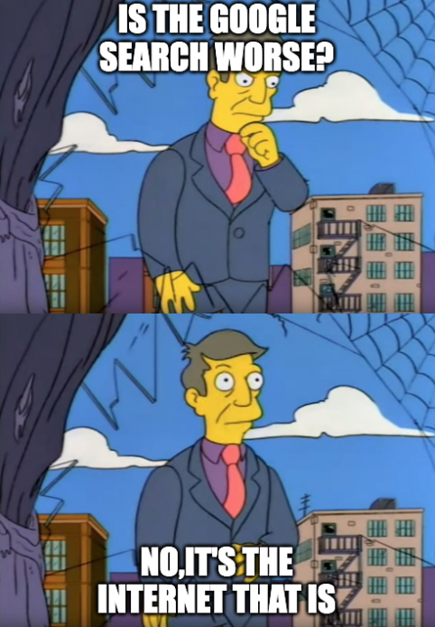
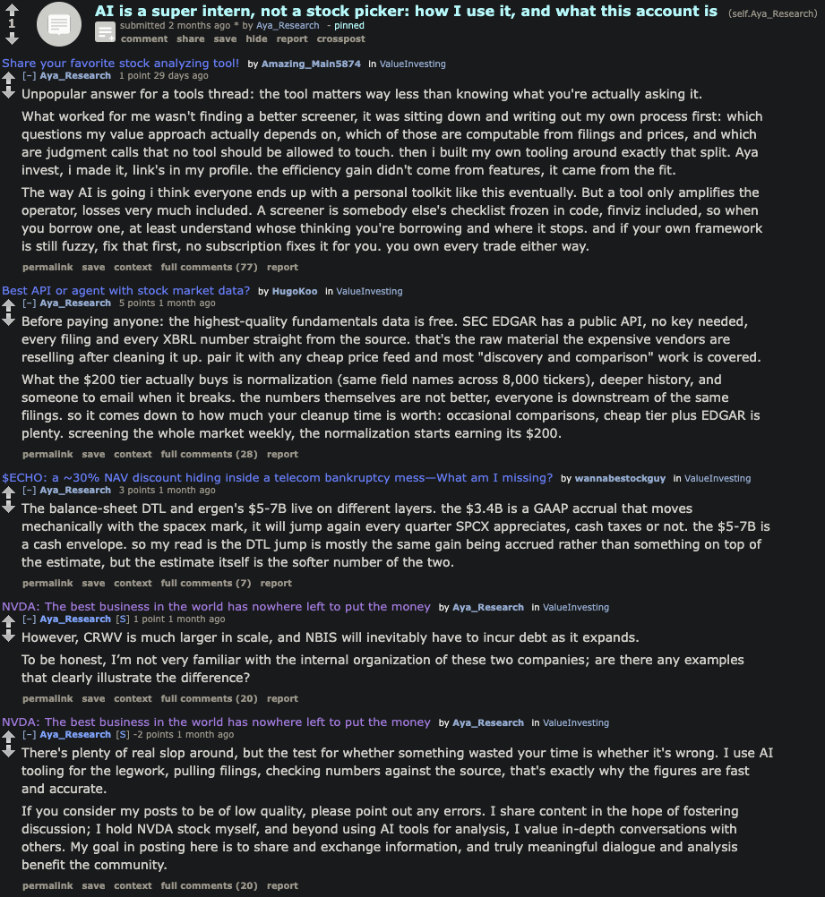
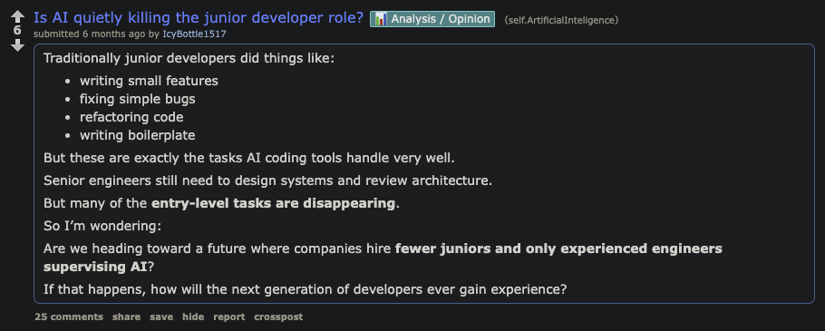
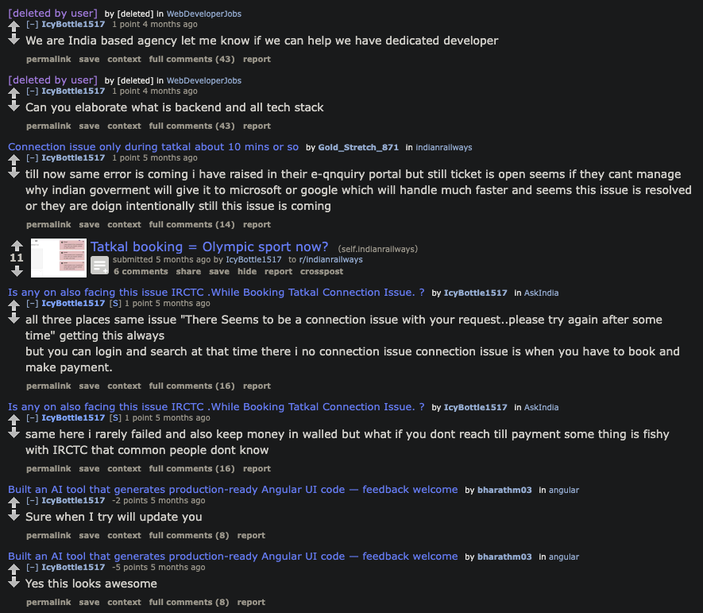
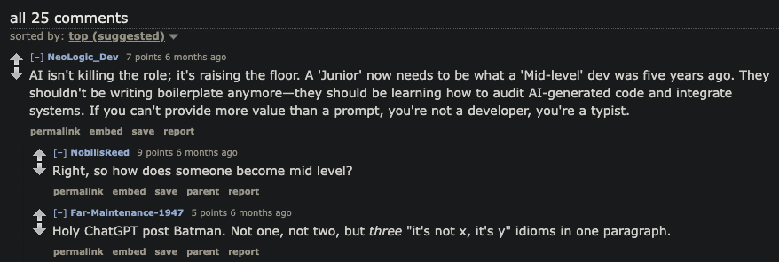
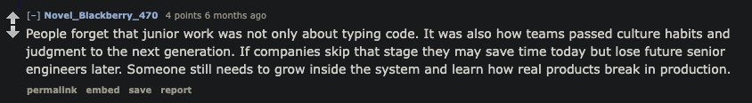
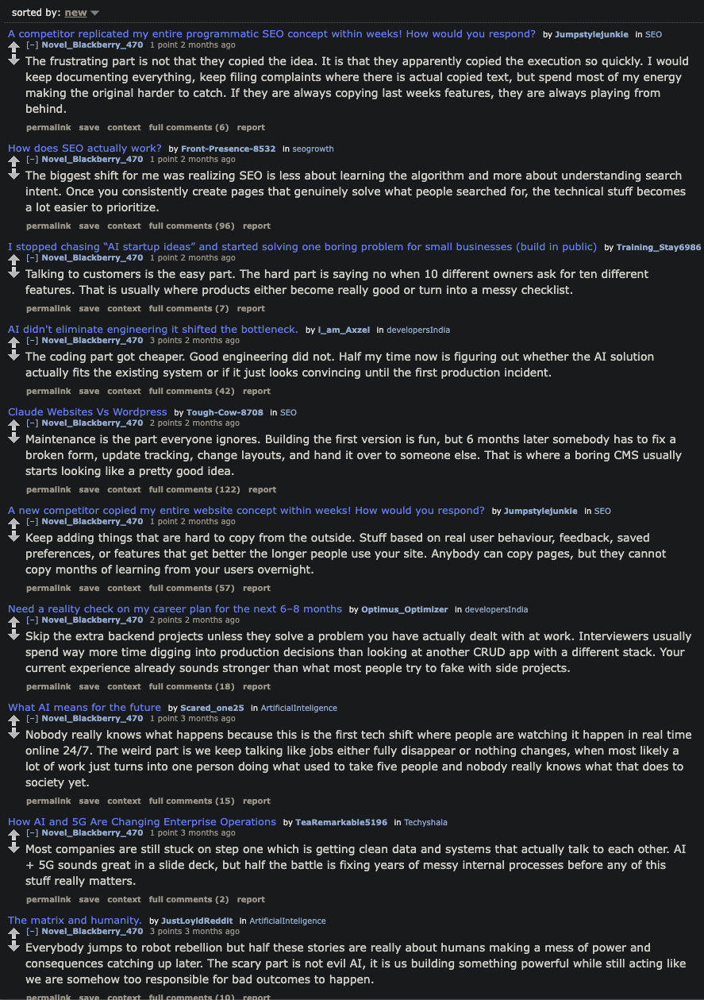

# The expected trajectory of the internet makes me sad
"Is Google Search getting worse?"
"No, it's the internet that is."
Oh, and that's a bigger problem than the former, IMO.

<aside class="callout" data-callout="warning">

Disclaimer

My job, as of writing, is working on Google search.
As a result, please assume some level of bias.

</aside>

The modern internet sucks = Reddit sucks = walled garden platforms suck = it's not going to get any better.

---
### How much of my search results were AI?

Here I do an investigation into the authenticity of the top result that Google gave me for each query (in **bold** at the top, before each one).

**"is google not profitable"**
1. [r/ValueInvesting - I basically stopped clicking Google links months ago. Their quarter just explained why that doesn't matter.](https://www.reddit.com/r/ValueInvesting/comments/1v42rra/i_basically_stopped_clicking_google_links_months/)
	- You can obviously tell this POST is AI written and slop because of the shitty LLM prose.
	- Also, just look at the post history.
	- 
	- Yeah, whatever, man. I don't fucking care anymore. Fuck you.
2. **"will ai kill off junior swe roles"**
	- [r/ArtificialInteligence [sic] - Is AI quietly killing the junior developer role?](https://www.reddit.com/r/ArtificialInteligence/comments/1rv4rcb/is_ai_quietly_killing_the_junior_developer_role/)
		- Ok so straight off the bat, the subreddit name is spelt wrong. Let's look at the post.
		- 
		- Ok, it already reads like a shitty LLM engagement post:
			- Excess examples as bullet points, a human would just write 1 or 2 of those within the sentence as examples.
			- Bold text being used. This one is kind of debatable but, pre-2023~, almost nobody on Reddit used markdown, unless it was like a mod or meta post. Especially for this post, *nobody* would bother marking those phrases as bold. Come on, humans are lazy. That is our merit. Fuck, that's why LLMs are so popular - they made this post for the lazy twat posting.
			- Ends with an open-ended question to farm engagement.
		- To put the nail in the coffin for my suspicions on this post, OP is literally an Indian with awful English, so he can't have written this post.
			- (I am half-Indian, this is not a racist comment)
			- 
		- Ok, now on to the comments:
			- 
				- I think the comment at the bottom says it the most, but, if you can't tell that an LLM wrote this, I think you're beyond saving.
			- 
				- Ok, a nice, somewhat soothing comment. Let's check their post history!
					- 
					- Oops! All bot comments for future GEO farming!

---

Much like my thoughts on politics in my country, I once again feel like:
- I have a different (probably somewhat misinformed and ignorant) opinion to the majority.
- There's no clear direction for me, or us, to go from here. 

Some brainless moron reading this right now might be thinking - "ok, and whats wrong with AI answers ROFL?", to which I don't have the energy to respond to.

I'm going to miss you, pre-AI internet. You might have been filled with spam, but you were filled with less spam. Can we just hit the [undelete button already](https://worldofgoo.fandom.com/wiki/Deliverance)?
