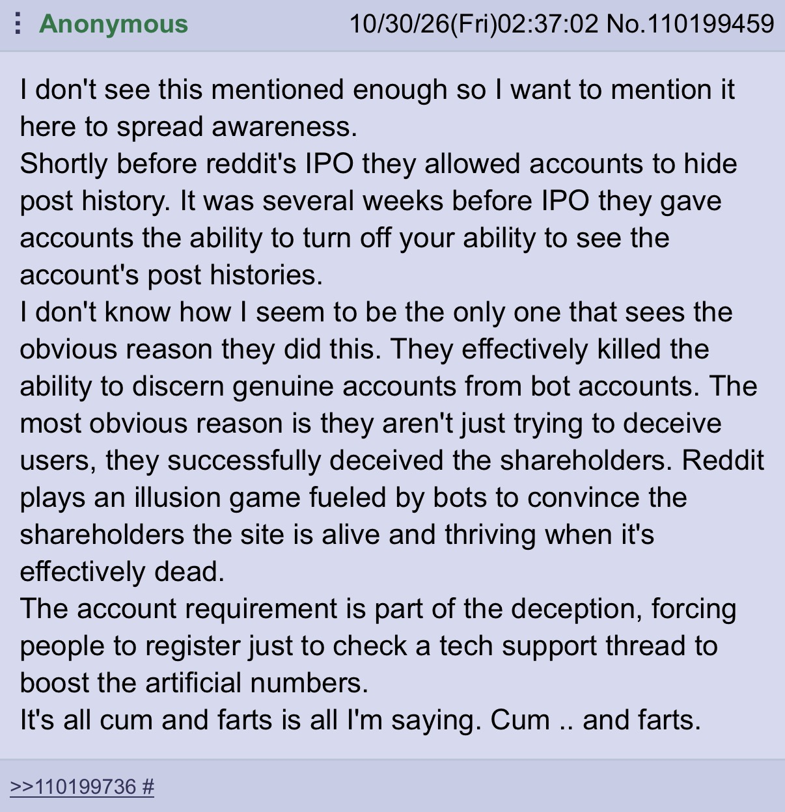

# Reddit is kil
no

## Another loss for the open internet!

While I'm still mad at this a little, because I do find Reddit threads useful to read for opinions (especially **old pre-2023 posts**), fortunately Steve Huffman and co have been enshittifying the site into an slop feed for morons for 5+ years, so I don't really care. Back in 2022 they introduced a new algorithmic feed, later making it the default, then in 2023 they removed the old, traditional "subscribed subreddits" feed. And with that, as soon as Reddit fell into the attention-centric design pattern like its competitors, my use for it stopped existing.

To be fair, Reddit has already been taken for what we need. Just ask any LLM what you need and it will spit out exactly what a Redditor would say. I wonder if my posts and comments have ever been used as training data?

## Actually wait who cares lmao
Reddit is like a good 40% bots and that % is only going to ticker up over time. proof
The platform is dead anyway and not only has the objective quality of posts gone down significantly over time (as those with a molecule of intelligence [realised it was about to become a shitfest](https://en.wikipedia.org/wiki/Reddit_API_controversy)),
It's 70% botted posts, comments and upvotes, mainly from someone buying accounts trying to not-so-subtly promote their product.
They censored the site to death (no source, just look into it, it's obvious if you used it before, say, 2019).

Also this guy puts into words what I was gonna say pretty well! It's bots all down the chain. Pretty ironic considering their [tagline](https://files.tek.rip/Pictures/lying_ass_tagline.webp)...
## Goypharms
I don't really give a fuck, but about 3 years ago, they perma-banned my account, which had 60,000 karma, and was 7 years old. Suspiciously, though, they didn't remove the *content* of my posts - only remove the poster ID. So now all my posts attributed me as the unidentifiable"*\[deleted]*". 

Normally I wouldn't care, because I *thought* like, absolutely zero people read anything I ever posted on there, so I wasn't really giving as much as I had taken. However, I was clearly wrong!

Before its deletion, I had **one** **singular** comment I posted that got 3 upvotes. In this comment,  I offered a Minecraft mod download to people if they added me on Discord, since said mod was effectively impossible to find + download - despite being really cool, at the time. 

Through that comment, I got about **80+** friend requests from random people asking me for it! And this is a comment with 3 upvotes, by the way. Now imagine how many people have read my other shitty comments and posts.

Fuck you, Reddit!

---

## Footnote
While researching for this blogpost, I found that they're also [killing off RSS thanks to scraping](https://techcrunch.com/2026/09/30/reddit-is-killing-rss-feeds-ending-public-api-access-because-of-ai-bots/).
RSS as in the web feed format developed by the late Reddit co-founder [Aaron Swartz](https://en.wikipedia.org/wiki/Aaron_Swartz)!
While I do actually think Spez would kill a family member to make his share prices go up, this is kind of unrelated - but it's a bit poetic!

Here's another good comment I saw online:

