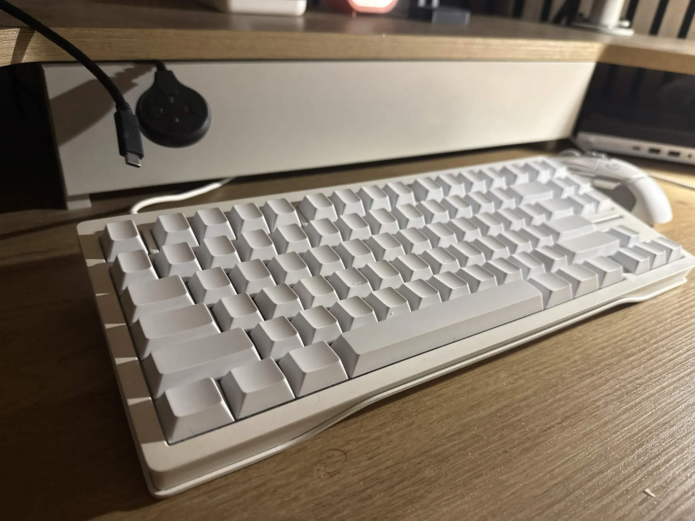
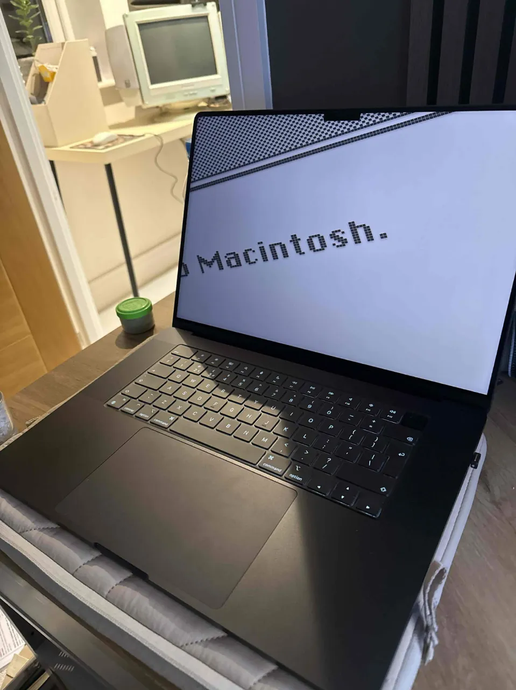

# WTF is wrong with modifier keys?
blah

## Preamble
1. I have 3 keyboards.
2. I travel between my home and the office
3. I use Linux and Mac.

Here's the keyboards, where I use them, and when I use them:

| Wooting 80HE                              | Standard MacBook built-in keyboard        | HHKB Hybrid Type-S                        |
| ----------------------------------------- | ----------------------------------------- | ----------------------------------------- |
| Home                                      | Travel                                    | Office                                    |
| Linux, Mac                                | Mac                                       | Mac                                       |
|  |  |  |

---

Before you accuse me of larp, and also buying needlessly expensive keyboards:
1. I got all of them for free.
2. I use them an equal amount.

The problem with having 3 keyboards is that when you move from one to another, if, dear god, you wish to do something involving a modifier key, you have to feel around and make $n$ stupid misinputs before you can do what you intended. The minor differences in layout jolt your brain really bad!
After about 8 months of putting up with this, I decided to sit down and actually fix my life, and save myself about 5 minutes total a day.
From previous attempts, I knew this was going to be a convoluted and confusing beast... I mean it doesn't sound like it, but when you have so many surfaces and environments it really does become a battle.
I had an existing setup that worked well enough for me which I set up during my first actual week at Google with a Mac, but by no means was it perfect!

If you are planning to copy what I do, or worse, ask AI to do this all for you, it's important you know; there are three layers, regardless of how many keyboards involved.
[Hardware](#Hardware)
[OS](#OS)
[Software](#Software)

## Configuration
**It is imperative you keep in mind your physical layout, first and foremost. The end goal of this guide is to have muscle memory parity across all your devices.**
Got it? Yay!
### Hardware
TODO
You can skip to the next section if none of your keyboards are configurable at the hardware level.
TODO
## OS
TODO
This is the bit I prefer about OSX:
- **Cmd** is the *application* modifier. 
	- Copy, paste, quit, close, save, find, new tab, e.t.c..
- **Option** is the *text* modifier.
	- By word nav, alt characters, + other functions that spilled off command :)
- **Ctrl** is the *terminal* modifier.
	-  `^C`, `^D`, `^Z`, blah... ~~not~~ rarely used outside of that purpose.

I don't know *why* I prefer it, I guess I've just spent the most time being productive on OSX more than any other OS. I typically do all my work SSH'ed in from OSX. And I primarily use my Linux desktop (and formerly Windows) to play my videya.

### Software
TODO
